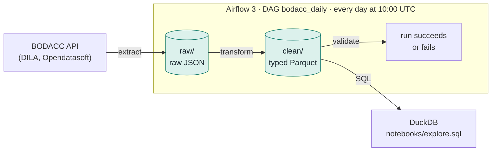

# SirenWatch

[](https://github.com/Totm33606/siren-watch/actions/workflows/ci.yml)


[](LICENSE)

**A daily data pipeline that collects French insolvency notices and turns them into a
typed, partitioned Parquet data lake you can query with SQL.**

Every day, the French official gazette of commercial notices, the
[BODACC](https://www.bodacc.fr/), publishes the court decisions on companies in
financial distress: safeguard (*sauvegarde*), receivership (*redressement judiciaire*)
and liquidation. SirenWatch fetches these notices from the public API, keeps the raw
response, cleans it into a typed table and validates it before anyone queries it.

**Airflow 3** orchestrates, **MinIO** stores (S3-compatible), **DuckDB** queries. The
whole stack starts with one command.



## What this project demonstrates

- **Orchestration with Airflow 3.** TaskFlow DAG with three tasks, cron trigger
  timetable, catchup and backfill. The stack is the official `docker-compose.yml`,
  adapted to the LocalExecutor (no Celery, no Redis).
- **An idempotent, partitioned data lake.** Hive-style partitions (`date=YYYY-MM-DD/`).
  Each run rewrites its own partition, so re-running a date never creates duplicates.
- **Robust API extraction.** Pagination with automatic fallback to the export endpoint
  above the 10,000-record window, and exponential backoff on network errors, 429 and
  5xx (honouring `Retry-After`). The number of records received must match the count
  announced by the API.
- **Data modelling and quality.** Nested JSON becomes a 17-column typed schema. SIRENs
  (French company IDs) are checked with the Luhn key, and about 45 court-decision
  labels are mapped to a procedure type and a stage. A validation task fails the run
  on any blocking check.
- **Cloud portability.** All storage goes through `boto3` with a configurable
  endpoint. Moving from MinIO to AWS S3 means changing environment variables, not code.
- **Tests without network.** Unit tests run on real, anonymised API responses
  (`httpx.MockTransport`, `moto`). DAG integrity is tested inside the production
  Airflow image, and both run in CI.
- **Privacy by design.** Natural persons are anonymised in the test fixtures, and
  personal addresses never reach the `clean/` zone.

## Results

A three-month backfill (August 1 to October 31, 2026), then a full re-run:

| Check | Result |
|---|---|
| Backfill | 92 daily runs, all successful |
| Full re-run (`REPROCESS=completed`) | 92 runs successful again |
| Objects in the lake, before and after the re-run | 198 (99 `raw/` + 99 `clean/`), no key added |
| `raw/` after the re-run | byte-for-byte identical (same ETags) |
| Duplicate `id_annonce` | 0 out of 49,473 notices |
| Storage | one day of notices: 3.6 MB of JSON becomes 84 KB of Parquet (zstd) |

## Documentation

| Document | Content |
|---|---|
| [docs/architecture.md](docs/architecture.md) | **Orchestration diagrams**: the containers and how they talk, one run step by step, the backfill, and what each Airflow component reads and writes in the metadata database. |
| [docs/pipeline.md](docs/pipeline.md) | **The three tasks**: what `extract` does, a **before/after** of `transform` on a real notice, the checks run by `validate`. |
| [src/sirenwatch/bodacc/README.md](src/sirenwatch/bodacc/README.md) | **The BODACC source**: endpoint, filter, pagination limits, useful fields, mapping to the `clean/` schema, classification of court decisions, fixtures. |

## Quick start

Requirements: Docker (Compose v2.14+), GNU make, [uv](https://docs.astral.sh/uv/),
openssl, and at least 4 GB of RAM for Docker.

```sh
git clone https://github.com/Totm33606/siren-watch.git
cd siren-watch
make up      # creates .env (with generated secrets), builds the image, starts everything
make ps      # container status
make logs    # follow the logs
make down    # stop (data is kept)
```

On Linux, set `AIRFLOW_UID=$(id -u)` in `.env` before the first `make up`.

| Service | URL | Credentials (in `.env`) |
|---|---|---|
| Airflow | http://localhost:8080 | `_AIRFLOW_WWW_USER_USERNAME` / `_PASSWORD` |
| MinIO console | http://localhost:9001 | `MINIO_ROOT_USER` / `MINIO_ROOT_PASSWORD` |
| S3 API | http://localhost:9000 | `AWS_ACCESS_KEY_ID` / `AWS_SECRET_ACCESS_KEY` |

The `sirenwatch` bucket is created automatically. The `bodacc_daily` DAG starts
**paused**: enable it in the UI, or with
`docker compose exec airflow-scheduler airflow dags unpause bodacc_daily`. It then runs
every day at 10:00 UTC and processes that day's publication.

## Usage

```sh
# Load a period (END included), at most 3 dates in parallel
make backfill START=2026-08-01 END=2026-10-31

# Re-run it entirely: each date rewrites its partition, without duplicates
make backfill START=2026-08-01 END=2026-10-31 REPROCESS=completed

# Query the data lake from your machine (procedures by type, department, month…)
make explore
```

`make explore` runs [notebooks/explore.sql](notebooks/explore.sql) with DuckDB and its
`httpfs` extension, straight from MinIO. The SQL file contains no credentials: DuckDB
reads them from the environment, loaded from `.env`. For example, new procedures by
month, department and type:

```sql
SELECT
    strftime(date_parution, '%Y-%m') AS mois,
    departement,
    type_procedure,
    count(*)                         AS procedures_ouvertes
FROM annonces
WHERE evenement = 'ouverture'
  AND type_avis = 'annonce'
GROUP BY ALL
ORDER BY mois, departement, type_procedure;
```

Column names are in French, like the source and the legal domain (`date_parution` is
the publication date, `evenement = 'ouverture'` means a procedure was opened). The
full mapping is in [the source documentation](src/sirenwatch/bodacc/README.md).

## Development

```sh
make test               # unit tests, no network (fixtures + simulated S3)
make lint               # ruff check + ruff format --check
make test-dags          # DAG integrity, run inside the Airflow image
make test-integration   # real round trip with MinIO (requires make up)
make format             # reformat the code
```

- **Business logic** lives in `src/sirenwatch/`. The DAG only calls it with the run
  date. The package is installed into the Airflow image by the [Dockerfile](Dockerfile),
  so after changing `src/`, run `make up` again to rebuild the image.
- **The DAG folder** `dags/` is mounted as a volume: changes are picked up without a
  rebuild.
- **Windows.** Airflow does not install natively on Windows, so the DAG integrity tests
  run in the container (`make test-dags`), and `make test` skips them locally.

## Repository layout

```
├── docker-compose.yml        # Airflow 3.4 (LocalExecutor) + Postgres + MinIO
├── Dockerfile                # apache/airflow:3.4.0 + the sirenwatch package
├── .env.example              # template for .env (never committed)
├── Makefile
├── pyproject.toml / uv.lock  # dependencies managed with uv
├── .github/workflows/ci.yml  # lint, unit tests, image build, DAG integrity
├── dags/bodacc_daily.py      # the DAG: extract → transform → validate
├── src/sirenwatch/
│   ├── config.py             # environment variables
│   ├── storage.py            # S3 access (boto3), partition keys
│   └── bodacc/
│       ├── README.md         # source-related decisions
│       ├── extract.py        # API → raw/
│       ├── transform.py      # raw/ → clean/
│       └── validate.py       # quality checks
├── tests/                    # unit, DAG integrity, MinIO integration
│   └── fixtures/             # real API responses, anonymised
├── notebooks/
│   ├── explore.sql           # DuckDB queries
│   └── run_sql.py            # runner used by make explore
└── docs/                     # architecture and pipeline
```

## Roadmap

| Version | Scope |
|---|---|
| **V1** (this release) | BODACC collection, `raw/` and `clean/` zones on MinIO, validation, DuckDB queries |
| V2 | Enrich with the SIRENE company register (sector, size, creation date) |
| V3 | Run the tasks on Kubernetes (Helm chart, `KubernetesPodOperator`) |
| V4 | Real AWS: S3, Athena, infrastructure with Terraform |

## Notes

- **MinIO image.** The MinIO project was archived in April 2026 and its official images
  are no longer published. This project uses `cgr.dev/chainguard/minio`, built from
  source and pinned by digest in `docker-compose.yml`.
- **Personal data.** About 14% of debtors are sole traders, i.e. natural persons.
  `raw/` keeps the full response, addresses included, so MinIO must stay private.
  `clean/` drops the addresses. All ports are bound to `127.0.0.1`.
- **Wipe everything** (Airflow database and MinIO data): `docker compose down -v`.

## Data source and license

BODACC data is published by the [DILA](https://www.dila.premier-ministre.gouv.fr/) on
[bodacc-datadila.opendatasoft.com](https://bodacc-datadila.opendatasoft.com/) under the
[Licence Ouverte / Open Licence 2.0](https://www.etalab.gouv.fr/licence-ouverte-open-licence/).
The test fixtures contain real notices, in which natural persons were anonymised.

The code is released under the [MIT License](LICENSE).
