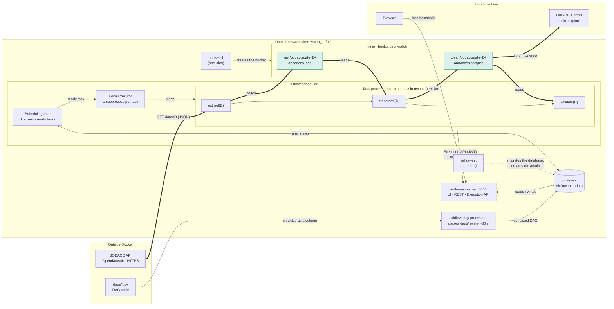
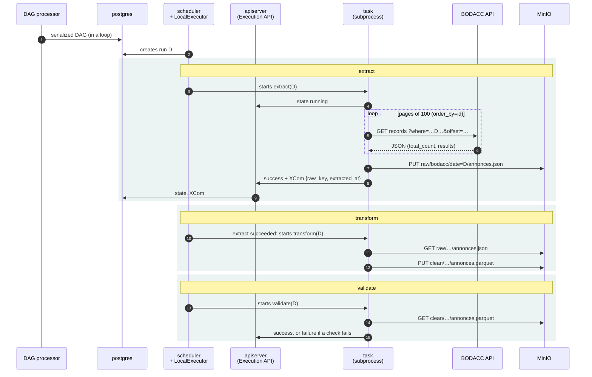
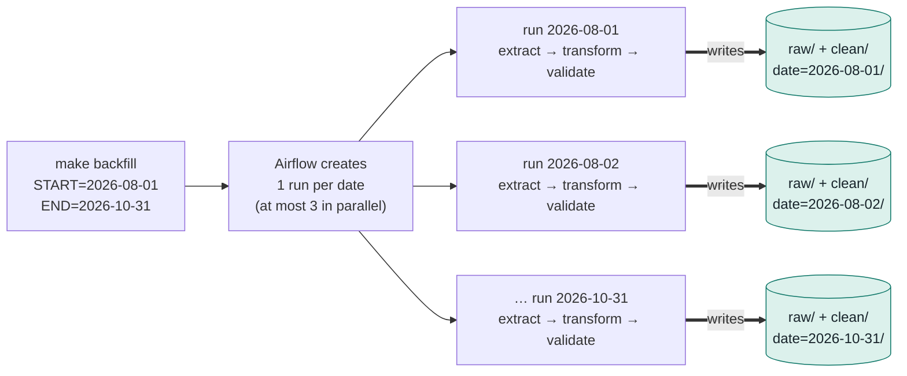

# Architecture and orchestration

This document explains **who does what** when the `bodacc_daily` DAG runs: the
containers, how they talk to each other, one run step by step, the backfill mechanism,
and what each Airflow component reads and writes in the metadata database. The three
tasks are described in [pipeline.md](pipeline.md).

In one sentence: **Airflow decides when and in which order; the tasks do the work.**
Only the tasks talk to the BODACC API and to MinIO.

## 1. The containers and how they talk



Legend: thick arrows (`==>`) are **data flows**, thin arrows are Airflow **control**,
dotted arrows are services that run **only at startup**.

### What each service does

| Service | Kind | Role |
|---|---|---|
| `postgres` | long-running | Airflow's **metadata database**: known DAGs, runs, task states, XCom, users. No business data. |
| `airflow-init` | one-shot | Migrates the database schema, creates the admin account and the shared folders, then exits with code 0. The other Airflow services wait for it. |
| `airflow-dag-processor` | long-running | **Reads the files in `dags/`** in a loop, executes them to extract their structure, and stores it in the database (serialized DAG). |
| `airflow-scheduler` | long-running | **The conductor**: creates the runs that are due, finds the tasks that are ready and hands them to the **LocalExecutor**, which lives in this container. Tasks run as subprocesses here: **this** is where the code from `src/sirenwatch/` runs. |
| `airflow-apiserver` | long-running, port 8080 | Web UI and REST API for you; **Execution API** for the tasks, which report their state here instead of writing to the database (JWT token). |
| `airflow-cli` | `debug` profile | Throwaway container for one-off commands (`make backfill`, `make test-dags`). |
| `minio` | long-running, ports 9000 and 9001 | **S3-compatible** object storage: the data lake (`raw/`, `clean/`). Chainguard image, since the MinIO project is archived. |
| `minio-init` | one-shot | Creates the `sirenwatch` bucket if it does not exist (`mc mb --ignore-existing`). |

All published ports are bound to `127.0.0.1`: the services are reachable from the local
machine only, not from the local network.

### Why is the DAG processor separate from the scheduler?

A DAG file is **Python code**: to know its tasks and its schedule, it has to be
executed. This *parsing* is done continuously by the DAG processor, which writes the
result to the database. The scheduler never reads `.py` files: it decides from the
database. A slow or broken DAG file therefore cannot block scheduling, and the
scheduler never runs user code.

As a consequence, the DAG file is executed **at two different moments**.

| When | Where | What runs |
|---|---|---|
| Parsing (every ~30 s) | DAG processor | module-level code: imports, `@dag(...)`, task declarations |
| Running a task | scheduler subprocess | the **body** of the `@task` functions |

This is why `bodacc_daily.py` imports `sirenwatch` **only inside the tasks**: at module
level, the import would be repeated on every parsing pass (an integrity test checks
this).

### How the code reaches MinIO: Docker network and published port

The same code runs in two places; only the `SIRENWATCH_S3_ENDPOINT_URL` variable
changes.

| The code runs… | It reaches MinIO via… | Thanks to… | Endpoint value |
|---|---|---|---|
| in an Airflow container (the DAG's tasks) | `minio:9000` | Docker's internal DNS, which resolves the service name | `http://minio:9000`, overridden in `docker-compose.yml` |
| on the local machine (DuckDB, integration tests, manual runs) | `localhost:9000` | the published port `"127.0.0.1:9000:9000"`, relayed by Docker | `http://localhost:9000`, in `.env` |

The credentials are the ones read by boto3 (and DuckDB): `AWS_ACCESS_KEY_ID` and
`AWS_SECRET_ACCESS_KEY`. `MINIO_ROOT_*` is only used by the MinIO server. Moving to
real S3 means changing these variables and clearing the endpoint, without touching the
code.

## 2. One run, step by step

The run for date **D** is triggered at D 10:00 UTC (`CronTriggerTimetable`). Its logical
date is its trigger time: it processes the publication of day D, loaded by the DILA
around 06:00–07:00 UTC.



**Data never flows through Airflow.** `extract` drops the JSON into MinIO, `transform`
reads it back, `validate` reads the Parquet. Between two tasks, only a small **XCom**
travels (the key written, the extraction timestamp, a few metrics), stored in
Postgres. `transform` and `validate` also report their state to the apiserver, like
`extract`; these messages are left out of the diagram.

## 3. Backfill: one run per date



A task processes **a single date**; Airflow multiplies the runs. Each run writes **its
own** `date=D/` partition. Re-running a date (`REPROCESS=completed`) rewrites that
partition and nothing else: this is what makes the pipeline **idempotent**.

### What the command does, and what it does not

`make backfill` runs, in a throwaway `airflow-cli` container:

```sh
airflow backfill create --dag-id bodacc_daily --from-date START --to-date ENDT23:59:59 \
    --reprocess-behavior none --max-active-runs 3
```

This command **runs no task**. It computes the logical dates of the window from the
DAG's schedule, records one queued run per date in Postgres, and exits. The
**scheduler** then executes these runs, in its own container. This is why the
scheduler, not `airflow-cli`, depends on MinIO in `docker-compose.yml`.

If the scheduler is not running, or if the DAG is paused, the runs stay queued
**without any error**. `make backfill` therefore checks both conditions before creating
the runs, and stops with an explicit message otherwise.

| Option | Effect |
|---|---|
| `--to-date END` + `T23:59:59` | `END` included: a bare date means midnight and would exclude the run of END, triggered at 10:00 |
| `--reprocess-behavior` (`REPROCESS`) | `none` skips dates that already have a run, `failed` re-runs failures, `completed` re-runs everything |
| `--max-active-runs 3` | limit specific to the backfill. The DAG's `max_active_runs` only applies to non-backfill runs. |

Airflow 3 behaviours worth knowing:

1. **A paused DAG runs nothing**, not even a backfill.
2. **Catchup** (`catchup=True`) starts from the **latest existing run**, not from
   `start_date`. A backfill launched before enabling the DAG therefore moves that
   starting point forward.
3. A backfill **ignores `start_date` and `catchup`**: only the `--from-date` /
   `--to-date` window matters. August to October was loaded with a `start_date` of
   November 1.
4. With `REPROCESS=none`, Airflow prints "Created backfill Dag run" even for a date it
   **skips** because a run already exists. The message is misleading; the result is
   not.

## 4. The metadata database: who reads and writes what

The DAG processor, the scheduler and the apiserver **never talk to each other
directly**: they communicate only through tables in the Postgres database.

| Table | Content | DAG processor | Scheduler | Apiserver (UI, Execution API) | Backfill CLI |
|---|---|---|---|---|---|
| `dag` | one row per DAG: paused or not, next planned run, limits | **writes** `last_parsed_time`, `max_active_runs`, `next_dagrun*` | **reads**, then **writes** `next_dagrun*` | reads; **writes** `is_paused` | reads |
| `serialized_dag` | DAG structure as JSON, `dag_hash` | **writes** when the hash changes | **reads** (schedule, tasks, dependencies) | reads (graph view) | reads (computes dates) |
| `dag_version`, `dag_code` | DAG version number, source code | **write** when the DAG changes | reads | reads | reads |
| `dag_run` | one row per run | reads (latest run, to compute the next one) | **writes**: creates scheduled runs, `queued → running → success/failed` | reads; **writes** manual runs | **writes** backfill runs |
| `backfill`, `backfill_dag_run` | backfill window and limit | — | reads | reads | **writes** |
| `task_instance` | one row per task and per run | — | **writes**: creates the rows, `scheduled → queued` | **writes** `running → success/failed`, on behalf of the task | — |
| `xcom` | small messages between tasks | — | — | **writes** / reads for the tasks | — |

Three points stand out:

1. **The DAG processor never creates a run.** It describes the DAG and keeps the `dag`
   row up to date. It parses the file about every 30 s, but only writes a new
   `serialized_dag` version when the DAG's hash changes.
2. **Nobody writes a scheduled run in advance.** The `dag` row only holds
   `next_dagrun`, the logical date of the next run, and `next_dagrun_create_after`,
   the earliest time it may be created. They are equal with a trigger timetable, and
   `next_dagrun_create_after` is set to `NULL` while `max_active_runs` is reached. On
   each loop, the scheduler looks for active DAGs whose `next_dagrun_create_after` has
   passed, **inserts the `dag_run` row itself**, and moves `next_dagrun` to the next
   day.
3. **The scheduler does not record task success either.** The task reports it to the
   apiserver through the Execution API, and the apiserver writes `task_instance` and
   `xcom`. The scheduler then sees that all tasks are finished and marks the run as
   successful.

Runs therefore have three origins, but one shared path: once a `dag_run` row is
`queued`, whether it was created by the scheduler (scheduled), the CLI (backfill) or the
apiserver (manual), the scheduler starts it and executes its tasks in the same way.
