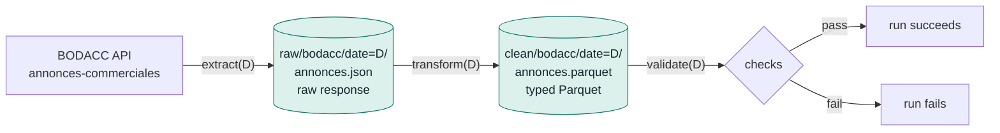

# The pipeline: extract → transform → validate

Each run of the `bodacc_daily` DAG processes **one publication date D**, in three
tasks. All the logic lives in `src/sirenwatch/bodacc/`; the DAG only calls these
functions with the run date. Source-related decisions (endpoint, fields, mappings) are
detailed in [src/sirenwatch/bodacc/README.md](../src/sirenwatch/bodacc/README.md).



| Task | Reads | Writes | Function |
|---|---|---|---|
| `extract` | BODACC API | `raw/bodacc/date=D/annonces.json` | `sirenwatch.bodacc.extract.extract(date)` |
| `transform` | `raw/…` | `clean/bodacc/date=D/annonces.parquet` | `sirenwatch.bodacc.transform.transform(date, date_extraction)` |
| `validate` | `clean/…` | nothing: succeeds or fails, and logs | `sirenwatch.bodacc.validate.validate(date)` |

Three rules apply to all three tasks:

- **Explicit date.** Each function receives `date: datetime.date` and never reads the
  clock. Even `date_extraction` is provided by Airflow (the start time of `extract`).
- **Idempotence.** Each task rewrites **the same key** for a given date. An S3 PUT
  replaces the object atomically: re-running a date never creates duplicates.
- **Hive partitioning** (`date=YYYY-MM-DD/`). DuckDB, Spark or Athena read the date
  from the path and only scan the partitions they need.

---

## extract: fetch the raw response

**Role:** fetch from the API **all** the insolvency notices published on day D, and
store them **unchanged** in the `raw/` zone.

- **Server-side filter:** `familleavis = "collective" AND dateparution = date'D'`. Only
  the relevant notices travel over the network.
- **Pagination:** `records` endpoint, pages of 100 (the maximum), sorted by `id` for a
  stable order. Above 10,000 results (the pagination window), automatic fallback to the
  `exports/json` endpoint. The record so far is 3,007 notices in a single day.
- **Consistency check:** the number of notices received must equal the announced
  `total_count`, with no duplicate `id`. Otherwise (dataset modified during
  pagination), the task fails and Airflow retries it from scratch.
- **Retries:** 5 attempts with exponential backoff (2, 4, 8, 16 s) on network errors,
  timeouts, 429 and 5xx. The `Retry-After` header is honoured. No retry on other 4xx
  (invalid request). The 2 Airflow retries (5 min apart) cover longer outages.
- **Day without publication:** the API returns 0 results; `[]` is written, an empty but
  valid partition.

Why keep a `raw/` zone? If a `transform` rule changes (new column, revised
classification), **`transform` can be replayed over the history** without querying the
API again. The raw data is the source of truth.

---

## transform: from nested JSON to typed Parquet

**Role:** turn each raw notice (32 fields, two of which are strings containing JSON)
into **one typed row of 17 columns**, ready for analysis. Column names are in French,
like the source and the legal domain.

### Before / after, on a real notice

Example from the fixture: the closing of a liquidation that concerns **two companies**.

**Before: `raw/` (excerpt from the API response)**

```json
{
  "id": "A202602052793",
  "dateparution": "2026-10-25",
  "typeavis": "annonce",
  "familleavis": "collective",
  "numerodepartement": "41",
  "tribunal": "Greffe du Tribunal de Commerce de Blois",
  "commercant": "LE PUNCH, SCV PERCHAIE",
  "ville": "Vendôme",
  "registre": ["345239875", "345 239 875", "521018788", "521 018 788"],
  "listepersonnes": "{\"personne\": [{\"typePersonne\": \"pm\", \"numeroImmatriculation\": {\"numeroIdentification\": \"345 239 875\", …}, \"denomination\": \"LE PUNCH\", …}, {…, \"denomination\": \"SCV PERCHAIE\", …}]}",
  "jugement": "{\"type\": \"initial\", \"famille\": \"Jugement de clôture\", \"nature\": \"Jugement de clôture pour insuffisance d'actif\", \"date\": \"2026-10-02\", \"complementJugement\": \"…\"}",
  "url_complete": "https://www.bodacc.fr/pages/annonces-commerciales-detail/?q.id=id:A202602052793",
  "…": "+ 20 other fields (region, PDF, deed, filing, misc.)"
}
```

Four difficulties stand out:
- `jugement` and `listepersonnes` are **JSON encoded in a string**;
- `registre` repeats **each SIREN twice** (with and without spaces);
- the notice concerns **two debtors**;
- nothing directly states the **procedure type**: it must be inferred from the label.

**After: `clean/` (one Parquet row)**

| Column | Type | Value | Rule |
|---|---|---|---|
| `id_annonce` | string | `A202602052793` | `id` as is (unique) |
| `date_parution` | date | `2026-10-25` | text → real date |
| `siren` | string | `345239875` | first SIREN, filled **only** if it has 9 digits and passes the Luhn check |
| `siren_brut` | string | `345239875` | source value, never corrected |
| `sirens` | list\<string\> | `[345239875, 521018788]` | **all** valid SIRENs, deduplicated: no debtor is lost |
| `nb_personnes` | int32 | `2` | number of debtors in `listepersonnes` |
| `raison_sociale` | string | `LE PUNCH, SCV PERCHAIE` | `commercant` |
| `type_procedure` | string | `liquidation` | **derived** from the label: sauvegarde / redressement / liquidation / indetermine |
| `evenement` | string | `cloture` | **derived**: ouverture / conversion / plan / cloture / creances / sanction / autre |
| `nature_jugement` | string | `Jugement de clôture pour insuffisance d'actif` | `jugement.nature`, extracted from the nested JSON |
| `date_jugement` | date | `2026-10-02` | `jugement.date` |
| `type_avis` | string | `annonce` | `annonce` (notice) or `rectificatif` (correction) |
| `tribunal` | string | `Greffe du Tribunal de Commerce de Blois` | as is |
| `departement` | string | `41` | **text** (`2A`, `974`…) |
| `ville` | string | `Vendôme` | as is, may be null |
| `url` | string | bodacc.fr link | `url_complete` |
| `date_extraction` | timestamp UTC | `2026-11-07 16:34:49+00:00` | provided by Airflow, never read from the clock |

What `transform` brings, in short:

- **Flattening** of the nested JSON, and **typing** of dates and integers.
- **Reliable SIRENs.** The raw value is kept, the validated SIREN is separate. The
  `sirens` list also recovers craftspeople whose SIREN only appears in
  `inscriptionRM`, about a quarter of the SIRENs missing from `registre`.
- **Classification.** The ~45 court-decision labels observed are mapped on two axes,
  "which procedure" (safeguard, receivership, liquidation) and "which stage" (opening,
  conversion, plan, closing, claims, sanction). This is what makes it possible to count
  **opened** procedures rather than notices.
- **Data minimisation.** Sole traders' personal addresses stay in `raw/` and do not
  reach `clean/`.
- **Format.** Parquet is columnar, typed and zstd-compressed: the November 6 file goes
  from 3.6 MB of JSON to 84 KB.
- **Explicit schema** (`CLEAN_SCHEMA`), even for an empty day, so that all partitions
  stay compatible with each other.

---

## validate: the safeguard that fails the run

**Role:** check the day's `clean/` partition **before** it is considered good. If a
**blocking** check fails, the task raises `ValidationError`: the run fails, visibly in
the UI. The checks are plain Python, without a heavy framework.

| Check | Blocking? | Why |
|---|---|---|
| Schema: columns and types identical to `CLEAN_SCHEMA` | yes | a partition with the wrong schema would break global reads |
| Required columns without nulls | yes | `id_annonce`, `date_parution`, `type_procedure`… |
| `siren` valid when present, and each element of `sirens` | yes | 9 digits and Luhn check |
| `siren` contained in `sirens` | yes | internal consistency |
| No duplicate `id_annonce` | yes | uniqueness guarantee of the table |
| All rows dated D | yes | a row from another date would skew the counts |
| `type_procedure` and `evenement` within their allowed values | yes | a typo in a rule would show up |
| Row count | logged | volume monitoring |
| Missing SIREN rate | logged | about 5% expected |
| Unclassified labels (`evenement = autre`) | logged | a new label from the DILA shows up here |
| Zero rows on a weekday | **warning** | the BODACC has genuine days without publication |

`validate` also returns a summary as XCom (`row_count`, `missing_siren_rate`,
`warnings`), visible in the UI, in the task's XCom tab.
